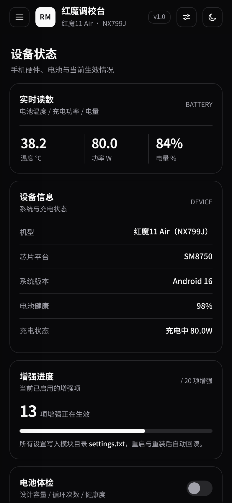
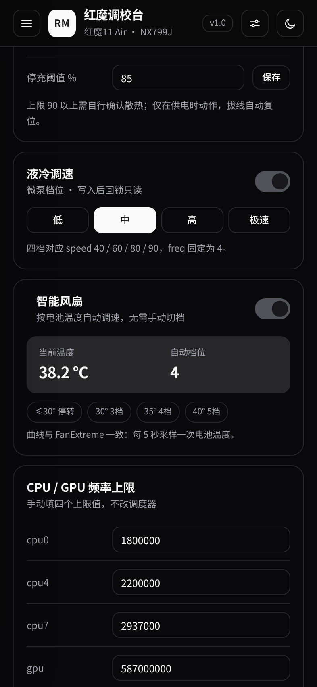
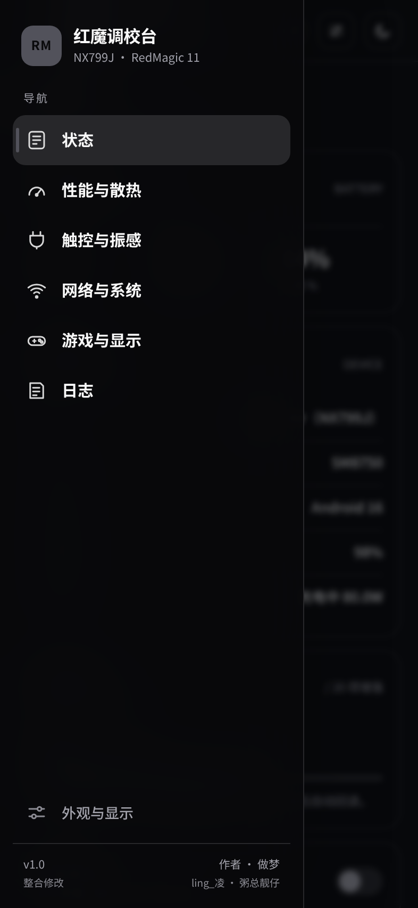
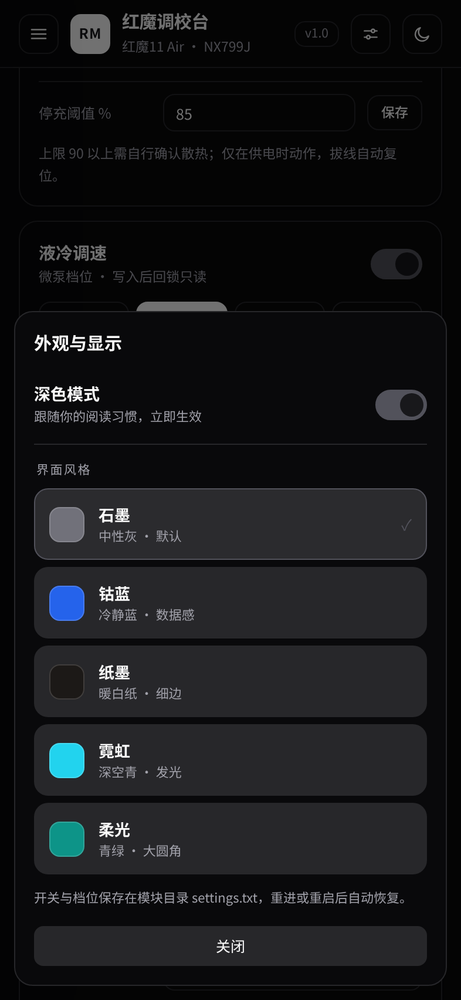

# 红魔调校台 · ling_凌 & 粥总靓仔

红魔 11 系列（NX799J）的 KernelSU / Magisk 综合调校模块，由 **做梦** 整合维护。一份模块带完常用增强：一个抽屉式 WebUI、六页功能、五套外观、按温度自动调速的风扇与液冷，设置统一落在模块目录的 `settings.txt`，重启或重进界面都能读回。

> 本模块为独立实现：仅参考公开的 sysfs 节点、Android 设置接口与社区讨论中的实现思路，**未包含 RedMagic-FanExtreme 或其它项目的源码**。早期版本中与其代码级对应的实现及自解压打包壳，已在 v1.3.0 全部移除并按独立架构重写。



## 功能一览

| 页面 | 内容 |
| --- | --- |
| 状态 | 电池温度 / 充电功率 / 电量、机型与芯片、电池健康、增强进度、电池体检 |
| 性能与散热 | 风扇档位、智能风扇（按温度自动调速）、液冷档位、CPU/GPU 频率上限、充电策略、温控与云控 |
| 触控与振感 | 触控采样率、跟手等级、指定应用模式、振动增益 / 时长 / 上限 |
| 网络与系统 | 三网信号增强、TCP 栈优化、WiFi 增强、蓝牙、深休眠、导航、云控 |
| 游戏与显示 | 亮度增强、屏幕峰值、亮度步进、手电筒、游戏显示相关开关 |
| 日志 | 一键生成诊断日志、节点自检（可用/缺失一眼看出） |

### 自动化

- **风扇曲线可调**：三个温度点（默认 30 / 35 / 40℃）与回滞（默认 2℃）都能改，升温到点升档，降档要低于「温度点 − 回滞」，避免临界点反复跳
- **场景策略**：填包名后，命中前台自动切到场景档位并开触控增强，退出还原
- **夜间静音**：设定时间段内停转风扇，场景与温度墙优先
- **温度墙**：超过设定温度强制 5 档，填 0 关闭
- **充电养护**：上限 80 / 90 / 100%，服务每 60 秒把节点压回设定值

### 智能风扇（按温度自动调速）

后台每 5 秒采样 `/sys/class/power_supply/battery/temp`，按整数摄氏度分档：

| 电池温度 | 风扇 |
| --- | --- |
| ≥ 40 ℃ | 5 档（满速） |
| 35 ~ 39 ℃ | 4 档 |
| 30 ~ 34 ℃ | 3 档 |
| < 30 ℃ | 停转 |

曲线与原实现一致：写节点前 `chmod 644`，写完 `chmod 444`；root 直写被 SELinux 拦截时自动改用 `su system` 身份写入 `fan_enable` / `fan_speed_level`。



## 导航

侧边栏是「大类 → 二级分类」结构：概览、性能与散热、触控与振感、网络与系统、游戏与显示、诊断与日志，共 21 个二级项。点大类展开，点二级项跳到对应卡片；页面上下滑到边界再继续滑，会切到同一类的上/下一项；底部有当前位置提示。

## 界面

- 左侧抽屉导航（汉堡按钮唤出，菜单项错峰入场，当前项带强调条），六页之间横向滑动
- 五套外观：石墨（默认）、钴蓝、纸墨、霓虹、柔光，右上角滑杆图标进入“外观与显示”，切换即时生效
- 深色 / 浅色双主题，跟随开关切换
- 外观与主题同样写入 `settings.txt`，WebView 禁用 localStorage 也不影响恢复

| 抽屉 | 外观与显示 |
| --- | --- |
|  |  |

## 安装

1. 手机已刷入 KernelSU / APatch，或 Magisk + WebUI 支持的管理器；
2. 管理器里安装 `redmagic_11_combo_v1.2.0.zip`；
3. **不用重启**：安装脚本会拉起 `apply_now.sh`，等安装器释放模块目录后接管 `modules_update`、替换正式目录并启动 service，约 10 秒生效；
4. 刷新模块列表，看到“已启用 N 项”后打开 WebUI。个别机型若 service 没起来，重启一次兜底。

要求：红魔 11 系列（NX799J / SM8750）。其他机型可以装，但风扇、液冷等节点不存在时对应卡片会自动隐藏或提示不可用。

## 设置备份与自检

- 外观设置里可“导出 / 导入 / 恢复默认”，导出文件为 `Download/redmagic_settings.txt`
- 日志页“节点自检”列出风扇、液冷、电池、触控、振动节点的存在性与当前值
- 模块内置 `updateJson`，管理器里可直接检查 `v1.2.0` 及后续版本


## 开源协议

本项目采用 **GPL-3.0-or-later**，见 [LICENSE](LICENSE)。

- 仓库内 Shell 脚本（`service.sh`、`post-fs-data.sh`、`customize.sh`、`apply_now.sh`、`cfg.sh` 等）、WebUI（`webroot/index.html`）全部为明文源码，不做 base64/gzip 混淆
- 允许学习、修改、再分发；修改后请保留原作者信息与出处
- `lumin/bin/luminpro` 来自 [YuleBest/LuminPro](https://github.com/YuleBest/LuminPro)（MIT），许可证与署名见 [NOTICE](NOTICE)；不属于本仓库原创代码，随包提供仅为功能完整，安装时可选择跳过
- 本仓库不包含 RedMagic-FanExtreme 的代码；两者仅存在功能思路层面的参考

## 设置文件

所有开关、档位、外观选择都会同步到：

```
/data/adb/modules/redmagic_11_combo/settings.txt
```

运行时状态另存于 `/data/adb/redmagic_11_combo/<键名>`。两者双向同步：界面改动先写运行目录并回读校验，再同步 `settings.txt`；重装或清空运行目录后从 `settings.txt` 恢复。

## 日志与自检

日志页“生成”会在模块目录写出 `last_log.txt`，包含：

- 设备型号 / 市场名称 / 系统版本 / 内核版本
- 各开关状态、充电与温控节点、液冷、风扇、振动、触控
- vendor 挂载、守护进程、内核参数
- KSU 最近错误

界面只显示前 20 行，完整内容直接看文件。若某项操作失败，界面会红字提示返回码，不再静默失败。

## 目录结构

```
.
├── module.prop          # 模块信息
├── customize.sh         # 安装脚本
├── post-fs-data.sh      # 早期启动
├── service.sh           # 启动服务（含智能风扇循环）
├── cfg.sh               # 设置读写 / 同步
├── desc.sh              # 管理器里动态改写“已启用 N 项”
├── settings.txt         # 设置持久化
├── log.sh               # 诊断日志
├── webroot/index.html   # WebUI
├── lumin/               # 亮度控制
├── bin/                 # 辅助工具
└── vendor/              # 相机等 vendor 配置覆盖
```

## 已知说明

- 部分开关依赖厂商节点，节点不存在时不会生效，界面会给出提示；
- 三网信号增强写的是 `persist.vendor.radio.*`，重启后生效；
- 振动、液冷等节点权限为 444，模块会在写入前后自动改权限；
- 不建议与其他“综合调校”模块同时安装，节点会互相覆盖。

## 致谢

- 风扇温控、节点写入与持久化思路：酷安 **@ling_凌**、**@粥总靓仔**
- 以及所有在酷安/GitHub 上公开折腾经验的朋友

## 免责声明

本项目仅供个人学习与自用，刷入前请确认你知道如何救砖。因使用本模块造成的任何设备问题、数据丢失，作者不承担责任。
